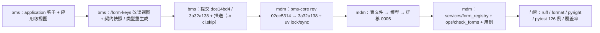

# 04 实施记录 · 组织主数据系统字段对齐

> mdm 产品奠基 · 01_组织主数据承接 · 子任务 02 · 嵌套子任务 04 · 实施记录 01

[文档首页](../../../../../../../文档首页.md) › [01 组织主数据承接](../../../01_组织主数据承接.md) › [02 组织主数据域实现](../../01_组织主数据承接_02_组织主数据域实现.md) › [04 系统字段对齐](../01_组织主数据承接_02_组织主数据域实现_04_组织主数据系统字段对齐.md) › 实施　|　[← 详细设计](../设计/01_详细设计_04_组织主数据系统字段对齐.md)

## 1. 信息 <a id="info"></a>

- 任务：`01_02/_04` 组织主数据系统字段对齐；对应需求 [01-5](../../../../../需求/01_需求_组织主数据承接.md#r01-5)。
- 详细设计：[01_详细设计_04_组织主数据系统字段对齐](../设计/01_详细设计_04_组织主数据系统字段对齐.md)（2026-10-22 定稿，§2 决策 8 项）。
- 交付日期：2026-10-22；Kiwi 用例 **2340**。
- 范围：**bms 仓**（`form_records()` 装配钩子，`02_11` 口径补全）＋ **mdm 仓**（表文件 / 模型 / 迁移 / 产品清单 / 校验脚本 / 用例）；两仓独立提交。

## 2. 过程与交付物 <a id="process"></a>



**bms 仓（02_11 口径补全，`feat(bms_core)`）**：

- `bms_core/application.py`：新增 `BaseServiceApplicationFactory.form_records()` 钩子（缺省空清单）；`create()` 内 `FormRegistry(merge_form_records(injected=…))` → `app.state.form_registry` + `app.state.form_injected_records`（**应用级视图**，无进程级注册表、不改 `FORM_CATALOG`）。
- `bms_platform/api/form_key.py`：`GET /api/v1/form-keys` 改读应用级视图（平台服务未注入时视图严格等于 `FORM_CATALOG`）。
- 用例：`libs/bms_core/tests/core/test_product_service_assembly.py::test_form_records_hook_merges_into_application_view`（Kiwi 2251 同验收项）、`services/platform/tests/api/test_form_keys_api.py::test_form_keys_reads_application_view`（Kiwi 2292 同验收项）。
- 连带重生成：`deploy/contracts/platform.json`（端点 docstring 进入契约描述）、`frontend/packages/api-types/src/platform.ts`。

**mdm 仓**：

```
mdm/backend/
├─ pyproject.toml                                  # bms-core rev → 3a32a138ff62a13820f7530b674c3d5a6d2fde9d
├─ services/form_registry.py                       # 新增：MDM_FORM_RECORDS（mdm_dept / mdm_post，同名闭合）
├─ services/org/src/mdm/main.py                # +form_records() 覆写；service_records / table_records 返回集合类
├─ services/org/src/mdm/models/dept.py         # +form_key（默认 mdm_dept）+ uq_mdm_dept_form_key_deleted_at
├─ services/org/src/mdm/models/post.py         # +form_key（默认 mdm_post）+ parent_id + uq_mdm_post_form_key_deleted_at
├─ alembic/versions/org/tenant/0005_mdm_form_key.py  # 新增迁移（server_default 回填后移除）
├─ ops/check_forms.py                              # 新增：清单 / 模型 / 关联表 离线校验
├─ tests/test_org_system_fields.py                 # 新增：模型列与约束（Kiwi 2340）
├─ tests/test_form_registry.py                     # 新增：清单 / 模型一致 / 钩子 / 视图 / CLI（Kiwi 2340）
└─ tests/test_org_migration.py                     # 链头改 0005 + 存量 form_key 回填用例
```

**关键实现口径**（与详设一致）：

- **`form_key` 取值**：`mdm_dept` / `mdm_post`（表名同名），`data_source_key` 同名闭合（与 bms `DATA_SOURCE_CATALOG` 既有跨项目登记对齐）。
- **常量由模型缺省提供**：`mapped_column(String(64), default=DEPT_FORM_KEY/POST_FORM_KEY)`，写入路径不改业务代码；`form_key` 不进 `BaseModel`。
- **迁移 0005**：`mdm_dept` / `mdm_post` 加列时带 `server_default` 回填存量 → 独立 batch 移除 `server_default` 并建 `(form_key, deleted_at)` 复合唯一；`mdm_post.parent_id` 可空、无缺省、**不建索引**（非层级字典）。
- **产品清单注入**：`services/form_registry.py::MDM_FORM_RECORDS` 为唯一出处，经 `mdm.main.ApplicationFactory.form_records()` 注入基座；关联表 4 张不登记、不落字段。
- **守卫**：`ops/check_forms.py` 断言 ① 清单非空 / 格式 / 跨表唯一 / 同名闭合 / 基座 `FormRegistry.validate()`；② 模型侧列 / 非空 / 缺省值 / 复合唯一；③ 反向（**本产品表集内**有 `form_key` 必须登记）；④ 字典表必带 `parent_id`；⑤ 关联表不得含 `form_key` / `parent_id`。

## 3. 问题与处置 <a id="issues"></a>

| # | 问题 | 处置 |
| --- | --- | --- |
| 1 | `form_key` 无产品注入入口：`merge_form_records(injected=…)` 已备，但应用装配未构造清单视图、`/form-keys` 直读常量 | 按拍板在 bms 补 `form_records()` 钩子 + 应用级视图（与 12_04 表归属注入同构）；mdm 侧自持清单经钩子注入 |
| 2 | bms 契约快照漂移：端点 docstring 变更进入 OpenAPI `description` | 重跑 `ops.contract_snapshot export`（仅 `platform.json` 描述变化，非破坏性）+ `api-types` 重生成（`platform.ts`） |
| 3 | **`bms-core` rev 升级带入 bms `08_05`（同构 tuple 整改 + 值对象字段归位）的类型口径变化**，mdm 侧 pyright 报 **13 err** | 按新口径对齐：`VerifiedToken.audience` / `ServiceRequest.json_body` / `EventContract.fields` 改**不可变集合类**（`ConcurrentStableFrozenList` / `ConcurrentStableFrozenDict`）；`service_records()` / `table_records()` 返回 `ConcurrentStableList`；顺带修 `test_branch_participant` 的 `json=` 字面量类型推断 |
| 4 | `ops/check_forms` 反向断言误报 `sys_config`（`Base.metadata` 同时含基座模型表） | 反向核对限定在**本产品表集**（`services.table_registry.table_names()`），与「产品自持」口径一致 |
| 5 | 存量回填用例构造 `mdm_post` 旧行时误加 `is_primary`（该列在 `mdm_user_post`） | 修正造数 SQL；回填用例通过 |

## 4. 验证 <a id="verify"></a>

| 命令 | 结果 |
| --- | --- |
| bms：`uv run pytest libs/bms_core/tests/core/test_product_service_assembly.py services/platform/tests/api/test_form_keys_api.py -q` | **16 passed** |
| bms：`uv run python scripts/tools/preflight/check-preflight.py --fast` | **全部通过**（ruff / format / pyright / 基座 / system-fields / 契约快照 + 事件契约 / api-types 零漂移） |
| bms：`check-links.py` | 断链 0 / 失效锚点 0 |
| mdm：`uv run ruff check .` / `ruff format --check .` | All checks passed / 99 files already formatted |
| mdm：`uv run pyright` | **0 errors, 0 warnings** |
| mdm：`uv run python -m ops.check_forms` | 通过（清单 2 项 + 模型双向一致 + 关联表未落系统字段） |
| mdm：`uv run pytest -q --cov=mdm --cov=services --cov=ops --cov-branch --cov-fail-under=70` | **126 passed**；Total **88.95%**（门槛 70% 已达） |

## 5. 覆盖率 <a id="coverage"></a>

| 变更源文件 | 行 + 分支 |
| --- | --- |
| `services/form_registry.py`（新增） | **100%** |
| `ops/check_forms.py`（新增） | **100%** |
| `models/dept.py` / `models/post.py` / `mdm/main.py` | 100%（声明 / 装配路径被用例执行） |

全量合计 88.95%（mdm CI 门槛 70%）。

## 6. 偏差与遗留 <a id="open"></a>

| # | 事项 | 处置 / 归口 |
| --- | --- | --- |
| 1 | **跨服务可见性**：`/api/v1/form-keys` 由 bms platform 服务提供，mdm 独立部署，其注入记录只进 **mdm 自身应用视图**，不会出现在 platform 响应里 | 需 bms 侧「产品清单下发 / 聚合」通道（或按 `DATA_SOURCE_CATALOG` 先例把产品表单标识作为跨项目示例登记）；**归口 bms 后续任务**，本任务交付通道本体与守卫 |
| 2 | 索引计数超出「每表 ≤ 5」提示值（`mdm_dept` 含公共 `idx_mdm_dept_deleted_at` 共 7） | 详设 §4 已登记；`form_key` 复合唯一为规范强制，暂不去冗余；索引整治统一立项时处理 |
| 3 | 达梦 `(form_key, deleted_at)` 复合唯一的 `NULL` 语义差异 | 沿用 bms《方言特性 · DM8》归口；三库真库实测随部署窗口（本地仅 SQLite 实测） |
| 4 | 管理面 / 只读出口契约不含 `form_key` | 决策 3 明确不暴露；界面「系统信息」展示随通用页面路由 / 表单框架阶段 |
| 5 | bms 侧 `/form-keys` 的 docstring 变更牵动契约快照与 `api-types` | 已随本次 bms 提交重生成，非破坏性变更 |

> 本文档依《文档生成规范》编写
