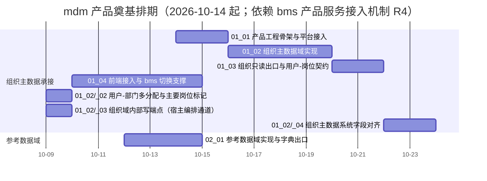

# mdm 产品奠基计划

> mdm 主数据管理 · 阶段一（mdm 产品奠基）排期计划：**已完成 4 项（含 `01_02` 及其 4 个嵌套子任务全部交付）**，剩余 1 项（**2026-10-11 追加需求域二「参考数据域」子任务 `02_01`（16h，立项未开工，暂不开发）**；`01_02` 于 2026-10-09 **二次重开**追加嵌套子任务 `02-02 用户-部门多分配与主要岗位标记`（16h）与**三次追加** `02-03 组织域内部写端点（宿主编排通道）`（32h），**两子任务均于 2026-10-09 当日交付**；**四次追加** `02-04 组织主数据系统字段对齐`（8h，需求 `01-5`）于 **2026-10-22 交付**，`01_02` 随之收口为**已完成**；`02-02` 为 bms 阶段七 `02_01/_01` / `02_02/_01` 的**前置、先行实施**；前端切址（bms `11_02`）与 bms `org` 退役验收为跨仓收尾）

[文档首页](../../../文档首页.md) › mdm 产品奠基计划　|　[任务基线 →](../任务/01_组织主数据承接/01_组织主数据承接.md)　[需求基线 →](../需求/00_需求_mdm产品奠基.md)

## 1. 计划说明 

- **排期对象**：阶段一 4 条需求**已全部建任务基线**——需求域一 [组织主数据承接](../任务/01_组织主数据承接/01_组织主数据承接.md)（4 子任务）；**2026-10-11 追加需求域二 [参考数据域](../任务/02_参考数据域/02_参考数据域.md)（1 子任务 `02_01`，立项未开工）**；**2026-10-11 追加需求 `01-5`（组织主数据表系统字段对齐）并作嵌套子任务 `01_02/_04`（2026-10-22 交付）**，阶段一需求 4 → 6 条。
- **顺序口径**：工程骨架与平台接入（01_01）→ 组织主数据域实现（01_02）→ 组织只读出口与用户-岗位契约（01_03）→ 前端接入与 bms 切换支撑（01_04）。**mdm 先实现、bms 后退役**：bms 侧组织服务退役（bms 阶段二 需求域十一）随本阶段 `01_03` 交付后推进。
- **跨仓前置依赖（已解除）**：`01_01` 依赖 bms「产品服务接入机制」（R4.1 / R4.2 / R4.3 后端侧）与共享基座产品服务装配支持（需求域十二）——**2026-10-07 已全部交付**。另因 `org` 标识冲突（与 bms 现役 `org` 服务行四项重复），经拍板**先执行 bms `11_01` 退役释放 `org` 标识**再由 mdm 承接（同批次协同改动：条目易主 / 产品路由映射 / 库名前缀参数化 / 网关路由分组 / 装配同值去重），bms 侧已交付并推送。
- **排期口径**：`01_01` **已于 2026-10-07 提前完成**（原计划窗口 2026-10-14 ~ 10-15）；`01_02` **已于 2026-10-07 交付**（原计划窗口 2026-10-16 ~ 10-19）；`01_03` **已于 2026-10-07 交付**（原计划窗口 2026-10-20 ~ 10-22）；剩余 `01_04` 窗口见 §3。
- **跨仓前置（已解除）**：`01_02` 依赖 bms 需求 `12-4` / 任务 `12_04`（表归属产品注入与合并视图 + 服务包模型名前缀参数化 + org 业务码动作码种子 + 关联表主键口径回写）——**2026-10-07 已交付并推送**（bms 提交 `f77c326a7`）；mdm 侧 `bms-core` 依赖 ref 随之升级至该提交。
- **跨仓前置（已解除，`01_04`）**：`01_04` 的 mdm 前端工程依赖 bms 三条基座能力——`05-12` / `03_04`（跨仓模块产物接入与产品前端模块发布，R4.3）、`05-13` / `06_02`（模块请求能力产品寻址：产品模块经 `api.product(产品键, 域)` 取数）、`05-11` / `06_03`（具名插槽显式上下文注入通道：非路由承载宿主页的插件上下文）——**2026-10-08 全部交付并推送**（Kiwi `2258` / `2259` / `2260`）。
- **跨仓前置（新增，`02_01`）**：`02_01` 依赖 **bms `02_10`（统一数据源注册与通用数据接口）+ `02_11`（系统字段 `form_key` 落表）**（在已交付 `BaseDictDataProvider` 抽象基类 + `RoutedDictSource` 出口基础上，补**可直用 / 可继承的通用数据出口实现类**——读标准字典系统字段表；实体表按《数据库开发规范》§3.1.3 落 `form_key`）；bms `02_10` / `02_11` 就绪后 mdm 方可落数据实体并接入出口。**本任务先立项、暂不开发**。
- **工时**：阶段合计 **204h**（`01_01` 16h ＋ `01_02` 52h ＋ `02-02` 16h ＋ `02-03` 32h ＋ `01_03` 24h ＋ `01_04` 40h ＋ `02-04` 8h ＋ `02_01` 16h）；其中**已完成 188h**（含 `02-04` 8h）、**未开工 16h**（`02_01`）。明细：`01_02` 52h 为重估（+8h 含事件契约登记、幂等 / 限流、表归属注入消费、`bms-core` ref 升级与回归；+12h 含嵌套子任务 `02-01` 部门编码与岗位码可改）；`01_03` 24h 重估（+8h 含跨仓平台用户只读出口契约联动、契约基线与 oasdiff 门禁、`user-roles` 缓存与失效代、数据范围 / 脱敏接线、组织域原型迁入）；`01_04` 40h 重估（+32h 范围扩容为含 mdm 前端工程全量——工程骨架与模块工程、部门 / 岗位管理页、四个具名插槽插件、契约类型包与零漂移门禁、前端 CI 作业、联调与原型对照）。
- **里程碑锚点**：mdm 阶段一「组织主数据承接」——组织主数据域可用、组织只读出口与用户-岗位契约就绪、bms `org` 服务退役可切契约。
- **负责人**：minjian（兼职，单人）。

## 2. 已完成任务 

| 编号 | 任务 | 工时（重估） | 完成日期 | 任务文件 | 偏差与遗留 |
| --- | --- | --- | --- | --- | --- |
| 01_01 | mdm 产品工程骨架与平台接入 | 16h | 2026-10-07 | [01_01](../任务/01_组织主数据承接/01_组织主数据承接_01_mdm产品工程骨架与平台接入/01_组织主数据承接_01_mdm产品工程骨架与平台接入.md) | 标识冲突经拍板改走「bms 先退役释放 `org` → mdm 承接」（bms `11_01` 提前执行，跨仓协同）；遗留：服务包模型模块命名映射（**已随 bms `12_04` 解除**）、契约基线与 oasdiff 门禁（随 01_03）、网关联调端到端、镜像与三库集成 CI |
| 01_03 | 组织只读出口与用户-岗位契约 | 24h | 2026-10-07 | [01_03](../任务/01_组织主数据承接/01_组织主数据承接_03_组织只读出口与用户-岗位契约/01_组织主数据承接_03_组织只读出口与用户-岗位契约.md) | 交付：组织数据源 / 名称回显 / 用户来源三端口（自 bms `bms_core/org` 迁入并按 mdm 本地装配）+ 出口五端点（`/org/data-source/{users,posts,dept-tree}`、`/org/resolve-names`、`/org/user-roles`，与管面路径分离）+ 双通道鉴权 + 数据范围 / 脱敏强制接入 + `user-roles` 结果缓存与**租户级失效代** + `330101` 用户维度 fail-closed + 公开契约基线与破坏性变更门禁（`ops/contract_gate.py` + CI）+ 组织域原型按模块迁入 + 跨仓 bms `02_06`（平台用户只读出口内部契约）。**偏差与决策**：响应序列改 `{items:[...]}` 包装（基座集合类须契约标注）、数据范围条件形态按 `Iterable` 判定、业务失败统一 HTTP 200 + 统一响应 `code`、user-roles 部门链**精确匹配不含子树**、`sys_user.dept_id` 取数通道回退为不引入（登记为 bms `02_01` 跨仓依赖）；**已回写详设 §4.1 与任务文档**。遗留：前端类型与生成门禁（01_04）、前端切路径与 bms 11_02 一次性切换、`users` 部门过滤切平台字段（bms 02_01）、`OrgUser.avatar` 补全、生产 Redis 与多副本失效验证 |
| 01_04 | 前端接入与 bms 切换支撑（**含 mdm 前端工程全量**） | 40h | 2026-10-08 | [01_04](../任务/01_组织主数据承接/01_组织主数据承接_04_前端接入与bms切换支撑/01_组织主数据承接_04_前端接入与bms切换支撑.md) | **交付**：前端工作区（`frontend/`：模块工程 `@mdm/module-org` + 类型包 `@mdm/api-types`；跨仓基座包经 `file:` + 工作区成员）＋ `@mdm/api-types` 契约类型生成与**零漂移门禁**＋ `mdm-org` 运行时模块（`routes` 4 / `regions` 3 / `i18nPacks` 2：部门管理页、岗位管理页、两表单页；用户分配岗位 / 岗位分配 / 部门分配三插件）＋ 数据通路（组织域经**产品域寻址** `api.product('mdm','org')`，平台用户经平台通道）＋ 前端 CI 三作业（lint / test / build）+ 跨仓发布演练（平台侧 `publish --module-dir`，跨仓条目入册）。**门禁**：契约类型零漂移 / `tsc`+`vue-tsc` / lint / **34 例 + 4 例** / 构建（入口 14.3 KB gzip / 6 块 / 预算内）/ 产物面隔离零违规 / 独立预览构建 / 后端 93 例与契约门禁。**原型对照**：按原型补齐后**逐页对照通过**（页内编辑 / `ancestors` 链 / 关键字筛选 + 多选批量删除 + 绑定角色入口 / 弹窗分配（部门筛选、树多选精确匹配）+ 单条解绑）；截图存 `mdm/temp/prototype-check/`。**偏差与决策**：跨仓基座包须纳入工作区成员（实测）；产品契约类型包为**类型面依赖**（devDependency，进运行时依赖会被平台发布前强校验拒）；独立预览目标**不启用 MF**（框架依赖本地提供，修白屏）；契约标识请求面整数声明按字符串透传（精度）；Kiwi **2261**。**遗留**：① 真实网关 / 令牌 / 三库端到端与前端切址（随部署与 bms `11_02` 联合验收）；② 契约标识请求/响应口径统一（建议后端契约面修正）；③ 表单 / 字段 / 按钮元数据种子；④ 生产托管与「拉取 + 构建」编排；⑤ 说明项：关闭（宿主职责）、导出（平台能力）、系统信息子页签、表单页编辑态切换、岗位侧角色绑定写端点缺（mdm 契约仅只读 `posts/{id}/roles`） |
| 01_02 | 组织主数据域实现（含嵌套子任务 `02-01` 部门编码与岗位码可改 / `02-02` 用户-部门多分配与主要岗位标记 / `02-03` 组织域内部写端点 / `02-04` 组织主数据系统字段对齐） | 52h ＋ 16h（`02-02`）＋ 32h（`02-03`）＋ 8h（`02-04`） | 2026-10-22（`_01` / `_02` / `_03` 已于 2026-10-08 / 10-09 交付；`_04` 于 2026-10-22 交付） | [01_02](../任务/01_组织主数据承接/01_组织主数据承接_02_组织主数据域实现/01_组织主数据承接_02_组织主数据域实现.md) | 交付：组织域六表落库与迁移链 `0001`~`0005`（部门树 / 岗位 / 四组分配）+ CRUD 与权限码 + 校验与唯一约束 + 审计占位 + 5 条 `org.*` 事件；子任务 `02-01` 部门编码（Kiwi 2268）/ `02-02` 用户-部门多分配与主要岗位（Kiwi 2272 / 2273）/ `02-03` 内部写端点与 XA 分支参与方 / `02-04` 系统字段 `form_key` / `parent_id` 对齐（Kiwi **2340**：迁移 `0005_org_form_key` + 产品清单 `services/form_registry.py` 经基座 `form_records()` 注入 + `ops/check_forms` 守卫；bms 侧同步补钩子并推送）均已完成 | 遗留（归口见各子任务实施记录）：三库真库迁移演练、字段级审计真实落库、内部写端点跨仓真机联调、契约「不进产品前端可见面」白名单确认、`form_key` 跨服务可见性（bms 产品清单下发通道）、索引计数提示 |

## 3. 剩余任务排期 

| 编号 | 任务 | 状态 | 工时 | 依赖 | 排期窗口 | 备注 | 偏差与遗留 |
| --- | --- | --- | --- | --- | --- | --- | --- |
| 02_01 | [参考数据域实现与字典出口](../任务/02_参考数据域/02_参考数据域_01_参考数据域实现与字典出口/02_参考数据域_01_参考数据域实现与字典出口.md) | 未开始 | 16h | bms `02_10`（统一数据源注册与通用数据接口）/ `02_11`（系统字段 `form_key` 落表），跨仓 | 2026-10-12 ~ 2026-10-14 | 2026-10-11 立项（纯参考类字典 `region` + uom/cur/settle/rate **数据实体**，继承 / 使用 bms 通用数据出口；实体表落 `form_key`；**暂不开发**） | 详细设计与实施随后续窗口；标识符（表前缀 / 错误码段 / 事件域）与 mdm 预留域对齐待详细设计 |

## 4. 排期甘特图 

## 5. 阶段一验收门禁 

| 验收点 | 对应任务 | 达成路径（结论与证据索引） |
| --- | --- | --- |
| mdm 服务可启动、经网关可达、服务目录登记通过 | 01_01 | **已达成（2026-10-07）**：① **可启动**——`/healthz` `/readyz` 均 200 且响应服务身份 `org`（启动 / 探针用例，ASGI 真跑）；② **服务目录登记校验通过**——`ops.check_modules` 通过（清单唯一与格式 + 产品维度四条断言 + **两侧同值**（平台侧 16 行对账）+ 服务包声明），装配期经基座产品维度 fail-closed 校验；③ **经网关可达**为**生成件证明**——平台侧 `PRODUCT_ROUTES` 登记 `mdm/org → org`（对外 `/api/mdm/v1/org/...`）、网关 upstream `org:8000` 与 Compose 服务名对齐；端到端联调随部署任务。证据见[测试记录](../任务/01_组织主数据承接/01_组织主数据承接_01_mdm产品工程骨架与平台接入/测试/01_测试_01_mdm产品工程骨架与平台接入.md)（39 用例 / 覆盖率 82.84% / ruff / pyright / 清单 / 契约零漂移全绿） |
| 组织主数据域 CRUD 与部门树可用、校验与审计生效 | 01_02 | **已达成（2026-10-07；2026-10-09 随 `02-02` 扩至六表）**：① **六表落库与迁移**——`org_dept` / `org_post` / `org_user_post` / `org_role_post` / `org_role_dept` / `org_user_dept` 模型 + `org:tenant` 链 `0001_org_tables`（业务五表）/ `0002_outbox_tables`（基础设施三表）/ **`0004_user_dept_and_primary`（`org_user_dept` 用户-部门多分配 + 两表 `is_primary` 主要项，2026-10-09）**，迁移升到 head 后库结构与链元数据**零漂移**，降级往返通过；② **部门树**——新建（`ancestors` 路径）/ 移动（防环 + 同事务级联更新子树）/ 删除引用检查（子部门 / 岗位 / 角色分配，逐项错误码 330054 / 330055 / 330056）；③ **岗位**——CRUD / 编码唯一与格式（`org.post_code_pattern`）/ 归属部门校验 / 删除引用（330034 / 330035）；④ **分配**——用户-岗位 / **用户-部门** / 角色-岗位 / 角色-部门全量覆盖（diff 后增删单事务）+ 解绑 + 用户删除清理（幂等）；⑤ **审计**——写操作经基座 `AuditCapturer` 占位 + 结构化操作日志（真实字段级审计随审计阶段）；⑥ **事件**——5 条 `org.*` 契约登记且快照零漂移，事件经事务性发件箱同事务写入（契约 enforce 放行）；⑦ **门禁**——pytest 64 例 / 覆盖率 **85.99%**（门槛 70%）/ ruff + format / pyright（strict 0 err）/ `ops.check_modules` / `ops.contract_snapshot check`（19 个管理面端点 + 探针）/ `ops.event_contracts check` 全绿。证据见[测试记录](../任务/01_组织主数据承接/01_组织主数据承接_02_组织主数据域实现/测试/01_测试_02_组织主数据域实现.md) |
| 组织只读出口真实取数、用户-岗位与按用户解析角色契约可用、事件发布 | 01_03 | **已达成（2026-10-07）**：① **出口五端点**——`/api/v1/org/data-source/{users,posts,dept-tree}` + `/api/v1/org/resolve-names` + `/api/v1/org/user-roles`（与 01_02 管理面路径分离），公开契约快照与基线一致；② **真实取数**——部门树一次性（嵌套 `children`）/ 岗位分页筛选（部门含子级）/ 用户经平台内部契约取数（**不跨库读 `sys_user`**，不可达即 `330101` fail-closed）/ 名称批量回显（三类目标、未命中占位、单批 `IN` 无 N+1）；③ **按用户解析角色**——岗位链 ∪ 部门链（精确匹配）并集去重保序 + 结果短时缓存与**租户级失效代**（写侧推进）；④ **鉴权与数据边界**——双通道鉴权（登录态 + 服务身份白名单）、数据范围与脱敏依赖**强制接入**（出口无旁路端点）；⑤ **事件**——5 条 `org.*` 契约快照零漂移且兼容（`ops.event_contracts check` 通过；消费方联调随 bms 11_02 / 阶段七）；⑥ **门禁**——pytest 93 例 / 覆盖率 **89.36%**（门槛 70%）/ ruff + format / pyright（strict 0 err）/ `ops.check_modules` / `ops.contract_snapshot check` / `ops.event_contracts check` / **`ops.contract_gate check`**（基线与破坏性变更门禁，已入 CI）全绿。证据见[测试记录](../任务/01_组织主数据承接/01_组织主数据承接_03_组织只读出口与用户-岗位契约/测试/01_测试_03_组织只读出口与用户-岗位契约.md) |
| 前端组织选择经 mdm 出口联通、bms `org` 服务退役验收通过 | 01_04 | **前端部分已达成（2026-10-08）**：① **可接入产物**——`mdm-org` 模块经独立构建产出远端产物（入口闭包 14.3 KB gzip / 6 块 / sourcemap 就位 / 元数据版本一致）并经平台侧 `publish --module-dir` 发布演练通过（§3 01_04 行；跨仓条目入册）；② **契约与类型**——`@mdm/api-types` 自产品契约快照生成、零漂移门禁入 CI，另有**契约对齐门禁**（前端调用面 ⊆ 契约、查询参数名合法、契约管理面端点全覆盖）与后端 93 例回归；③ **界面**——管理页与三插件经**可交互原型逐页对照通过**（实现页与原型页截图对照，测试记录 §4）。**待联合验收**：前端组织选择字段经 mdm 出口的**真实联通**（查询 / 批量回显 / 部门树一次性返回）与 bms `org` 服务退役验收——改址归 bms `11_02`（跨仓联合），随部署联调（真实网关 / 令牌 / 三库）。 |
| 参考数据级字典经 mdm 数据实体 + bms 通用出口联通 | 02_01 | **待达成（2026-10-11 立项）**：纯参考类字典（`region` 等）落 mdm 数据实体，经 **bms 通用数据出口**（直接使用 / 继承）按 `data_source_key` 取数，供 bms 字典出口 / 前端消费；实体表落 `form_key`；依赖 bms `02_10`（统一数据源注册与通用数据接口）/ `02_11`（系统字段 `form_key` 落表）。 |
| 组织主数据表系统字段对齐（`form_key` / `parent_id`）落表 | 01_02/_04 | **已达成（2026-10-22）**：① **落表**——`org_dept` 落 `form_key`（`org_dept`）、`org_post` 落 `form_key`（`org_post`）+ `parent_id`（非层级字典冗余、不建索引），两表各带 `(form_key, deleted_at)` 复合唯一，迁移 **`0005_org_form_key`**（`server_default` 回填后移除）；② **零漂移**——表文件 ↔ 模型 ↔ 迁移一致（`compare_metadata` 空 + 升降级往返 + 存量回填用例）；③ **清单**——mdm 自持 `services/form_registry.py::MDM_FORM_RECORDS`（跨表全局唯一 + `data_source_key` 同名闭合），经 **bms 新增装配钩子 `form_records()`** 注入应用级视图（bms `dce14bd4` / `3a32a138` 已推送，mdm `bms-core` rev 升级）；④ **守卫**——`ops/check_forms.py`（清单 / 模型 / 反向 / 关联表口径，新增模块覆盖率 100%）；⑤ **关联表**——4 张未落 `form_key` / `parent_id`（正反断言）。门禁：mdm pytest **126 例 / 88.95%**（门槛 70%）+ ruff + pyright（0 err）+ `ops.check_forms`；bms 定向 16 例 + `preflight --fast` 全绿。Kiwi **2340**。证据见[测试记录](../任务/01_组织主数据承接/01_组织主数据承接_02_组织主数据域实现/01_组织主数据承接_02_组织主数据域实现_04_组织主数据系统字段对齐/测试/01_测试_04_组织主数据系统字段对齐.md)。**说明**：`/api/v1/form-keys`（bms platform 服务）**不含**产品注入记录——跨服务可见性需 bms 产品清单下发通道，登记遗留（§7 #23）。 |

## 6. 风险与对策 

| 风险 | 影响 | 概率 | 缓解措施 |
| --- | --- | --- | --- |
| mdm 从零奠基，工程 / CI / 部署新建面大 | 中 | 高 | 平台能力（认证 / 权限 / 审计 / 事件 / 文件 / 字典）一律复用 bms，只建主数据域；组织域单域先落，其余域按需接入 |
| mdm 出口未就绪阻塞 bms 退役 | 中 | 中 | 顺序固定「mdm 先、bms 后」；bms 退役任务窗口排于 mdm `01_03` 之后（见 bms 阶段二计划） |
| 契约迁出（`bms_core/org` → mdm）影响面未清 | 中 | 中 | 退役前逐项核对 bms 侧调用点（`assembly` / `deps` / 前端出口），以预检零漂移闭环 |

## 7. 后续阶段待办 

| # | 事项 | 来源 | 归口 |
| --- | --- | --- | --- |
| 1 | 服务包模型模块命名映射（`bms_{service}.models` ↔ `mdm_{service}`） | `01_01` 实施记录 §6 | **已解除（bms `12_04`，2026-10-07）** |
| 2 | 公开契约基线与破坏性变更门禁（oasdiff） | `01_01` 实施记录 §6 | **已交付（`01_03`：`ops/contract_gate.py` + CI）** |
| 3 | 网关联调端到端可达（`/api/mdm/v1/org/...`） | `01_01` 实施记录 §6 | 部署联调任务 |
| 4 | 镜像构建与三库（MySQL / PostgreSQL / DM8）集成 CI | `01_01` 实施记录 §6 | 部署 / CI 后续 |
| 5 | 每服务租户库 `mdm_org_{租户}` 真库实建与迁移 | `01_01` / `01_02` 实施记录 §6 | 部署联调任务 |
| 6 | 前端类型产物与生成门禁（`@mdm/api-types`） | `01_03` 实施记录 §7 | **已交付（`01_04`，零漂移门禁入 CI）** |
| 7 | 前端切路径与 bms 侧一次性切换（`/api/mdm/v1`） | `01_03` 实施记录 §7 | **已交付（bms `11_02` + `01_04`，2026-10-08）** |
| 8 | `users` 出口部门过滤切平台 `sys_user.dept_id` | `01_03` 实施记录 §7 | **注销（2026-10-09）**：`sys_user.dept_id` 通道不引入（bms 需求 `07-11`），按「岗位归属部门」派生为本域最终口径 |
| 9 | `OrgUser.avatar` 平台契约未提供（恒空） | `01_03` 实施记录 §7 | **阶段十五（bms 2026-10-22 口径变更）**：头像 URL 归 bms 个人中心；mdm 侧恒空为设计口径，随阶段十五补契约后再接 |
| 10 | 岗位侧角色绑定写端点缺（mdm 契约仅只读 `posts/{id}/roles`） | `01_04` 实施记录 §6 | mdm 界面后续迭代；角色绑定写侧现走 bms 角色管理「角色分配」（`role-posts` / `role-depts` 插件） |
| 11 | 契约标识请求面整数声明 ↔ 响应面字符串（雪花）：前端按字符串透传 | `01_04` 实施记录 §6 | mdm 后端契约可选修正（`01_02` / `01_03` 域） |
| 12 | 真实网关 + 真实令牌 + 三库端到端联调 | `01_03` / `01_04` 实施记录 §6 | 部署阶段 / bms `11_02` 联合验收 |
| 13 | 生产托管（产物上传 / 静态托管基址 / CDN）与「拉取 + 构建」编排 | `01_04` 实施记录 §6 | 部署阶段 + 平台 R4.3 后续 |
| 14 | 表单 / 字段 / 按钮元数据种子 | `01_04` 实施记录 §6 | 后续阶段按需立项（属平台表单定制 / 字段权限体系） |
| 15 | 插件写操作乐观并发（多人同改角色分配） | `01_04` 实施记录 §6 | 后续（现为全量覆盖 + 随宿主保存，冲突由后端语义兜底） |
| 16 | 三库真库迁移演练（`0001_org_tables` ~ `0004_user_dept_and_primary`） | `01_02/_01` ~ `_03` 实施记录 §6 | 部署窗口 |
| 17 | 字段级审计真实落库（现接基座 `AuditCapturer` 占位） | `01_02` 实施记录 §6 | bms 审计合规模块 |
| 18 | 数据范围真实规则与敏感字段脱敏真实策略 | `01_02` / `01_03` 实施记录 §6 | bms 阶段七（权限侧已交付）/ 脱敏阶段 |
| 19 | 生产 Redis 与多副本失效代验证 | `01_03` 实施记录 §7 | 部署联调任务 |
| 20 | 四组内部写端点的跨仓真机联调（mdm 在场） | `01_02/_03` 实施记录 §6 | bms 跨仓真机联调窗口；**XA 链路本身已由 bms `05_07` 真库端到端覆盖（2026-10-18，4/4 通过）** |
| 21 | 内部写端点幂等键载荷回放用例（DI 覆写夹具下幂等存储与工作单元共用会话冲突） | `01_02/_03` 实施记录 §6 | mdm 续做（给幂等存储独立连接后补断言） |
| 22 | 契约快照「不进产品前端可见面」白名单确认 | `01_02/_03` 实施记录 §6 | mdm 收口项 |
| 23 | **组织主数据表系统字段对齐（需求 `01-5` / `01_02/_04`）**：`org_dept` / `org_post` 落 `form_key`、`org_post` 落 `parent_id`，表文件 ↔ 模型 ↔ 迁移零漂移并登记产品清单 | 2026-10-11 立项；bms `02_11` 登记的跨仓同步项 | **已完成（2026-10-22，8h，Kiwi 2340）**；**新登记遗留**：`form_key` **跨服务可见性**——`/api/v1/form-keys` 由 bms platform 服务提供、mdm 独立部署，产品注入记录只进 mdm 自身应用视图，需 bms 侧「产品清单下发 / 聚合」通道（归口 bms 后续任务）；索引计数超「每表 ≤ 5」提示（`org_dept` 含公共软删除索引共 7，详设 §4 已登记） |
| 24 | **参考数据域实现与字典出口（需求域二 / `02_01`）** | 2026-10-11 立项 | **单独排期（16h，不纳入阶段一本次收口）**；依赖 bms `02_10` / `02_11` 均已交付 |
| 25 | **接入 `engkit`（跨仓工程化工具包）并做全仓文档整改** | bms 需求 `13-5` / 任务 `13_05`（2026-10-22 立项，窗口 2026-10-26 ~ 2026-10-29） | **待 bms `13_05` 交付后接入**：① 声明 `engkit` git 源依赖（锁 rev）+ 仓根 `engkit.toml`；② 本地与 CI 接入 `links` / `docs-scope` / `preflight`（替代手敲 `ruff` / `format` / `pyright` / `pytest`）；③ 全仓需求 / 任务 / 实施 / 测试文档的**进度类字样清理**（唯一落点归阶段计划；本次 `01_02/_04` 交付已发现 2 处，随整改一并清）；④ biz / cw 由各自窗口接入 |
| 26 | **`engkit` 接入落地（本条为 25 的执行结果）** | bms 任务 `13_05`（2026-10-23 接入） | **已完成（2026-10-23）**：① `engkit` git 源依赖锁 rev + 仓根 `engkit.toml`（11 步预检 + 拦截口径）；② CI 新增 `docs-links` / `docs-scope` 两个 job，`backend-test` 保持全量；③ 存量文档整改 **18 行 / 10 文件**（实测断链 0、口径违规 0）；④ **覆盖率门禁统一为行 + 分支 100%**（原 70% 为本仓历史口径）：源码实测仅 89%（483 处缺口 / 19 文件），随接入一次补齐（新增 API 六路由 / 内部写通道 / 仓储 / 契约护栏 / 去重路径等用例；196 passed、`missing_lines=0 partial_branches=0`）；⑤ 顺带修复 3 处真实缺陷——删除端点「事务已开启」必然失败（dept / post）、角色缓存载荷解析与 DB 路径判重口径不一致、两处树构建的不可达兜底分支 |

> **台账口径**：本表汇总阶段一各任务遗留、外部依赖与后续阶段事项，逐条给归口；任务内已闭环项以「已解除 / 已交付 / 注销」登记，不重复展开明细（明细见各任务实施记录 §6/§7）。

> 本文档按 bms《[文档生成规范](../../../../bms文档/规范/文档生成规范.md)》与《[计划文档规范](../../../../bms文档/规范/计划文档规范.md)》编写
